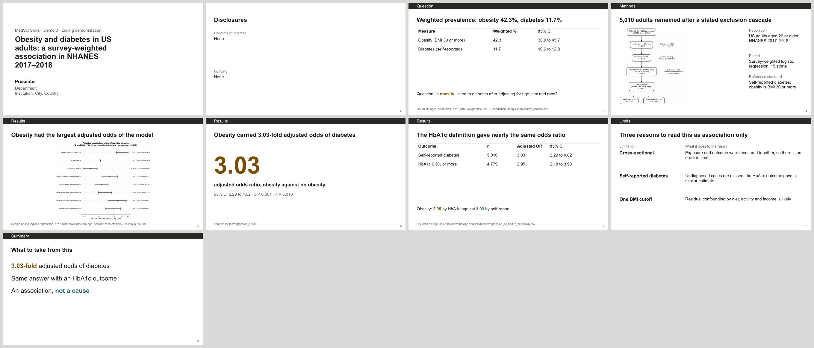

# Presentation

A 10-minute `conference_oral` talk built on the medsci slide template
(`skills/present-paper/templates/slide_template/`), stone palette, banded by default: the section
name on each white slide sits in a slim band across the top (Question, Methods, Results, Limits,
Summary; no band on Cover or Disclosure).



The image is a PowerPoint render of the built deck.

`build_deck.py` starts the deck with `new_deck.make_deck(palette="stone", band=True)` and fills it by
layout name and placeholder idx: `put_rich` for the spans in the two accent colours, `fit_picture` for the
figures the analysis already produced, `plain_table` and `set_cell` for the two small tables.
`make_deck.sh` builds it and runs the two gates this repository requires of a deck:

- `check_slide_tells.py`: the marks that make a deck read as machine-made.
- `check_deck_budget.py`: words per slide, slides per minute and a type-size floor, against the
  archetype declared in `deck.qc`.

**Every number on every slide is read from the shipped artifacts at build time.** There are no
typed-in figures in the deck script; change a result and the deck changes with it. Titles state
the finding, and the figures are the ones the analysis produced.

Slide text is English; speaker notes are Korean prose, per the presenter's convention.

```bash
bash make_deck.sh                              # build + both gates
python3 build_deck.py --plain plain.pptx       # the same slides without the band
```
