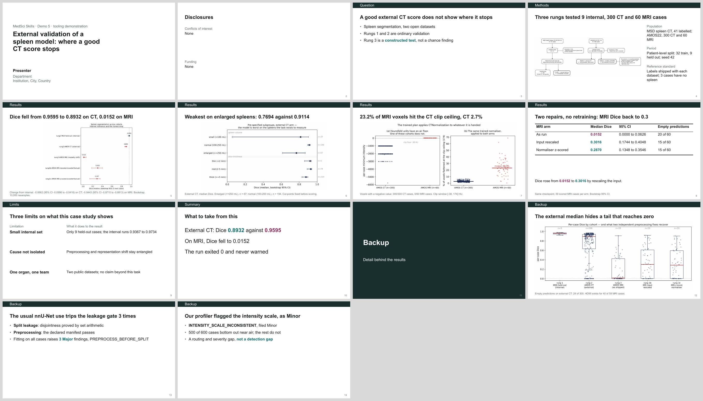

# Presentation

A 10-minute `conference_oral` talk built on the medsci slide template
(`skills/present-paper/templates/slide_template/`), in a set of colours worked out from one main
colour, teal `0B6E6E`; the template chooses the second accent. The deck is banded by default: the
section name sits in a slim band across the top of the white slides.



The image is a PowerPoint render of the built deck.

Ten presented slides: Cover, Disclosure, the question, the case flow, three result figures, one
small table, Limitations and Take-home. After a Backup divider come three slides for questions:
the tail of the external Dice distribution, the two leakage gates, and the profiler finding.

`build_deck.py` starts the deck with `new_deck.make_deck(main="0B6E6E", band=True)` and fills it by
layout name and placeholder idx: `put_rich` for the spans in the two accent colours, `fit_picture` for the
figures the analysis already produced, `plain_table` and `set_cell(accent=...)` for the table.
`make_deck.sh` builds it and runs the two gates this repository requires of a deck:

- `check_slide_tells.py`: the marks that make a deck read as machine-made.
- `check_deck_budget.py`: words per slide, slides per minute and a type-size floor, against the
  archetype declared in `deck.qc`. The clock stops at the Backup divider.

**Every number on every slide is read from the shipped artifacts at build time.** There are no
typed-in figures in the deck script; change a result and the deck changes with it. Titles state
the finding, and the figures are the ones the analysis produced.

The two accents have one meaning each across the deck: the first marks the result being judged
(external CT, MRI, the repaired arm); the second marks what it is set against (the internal
baseline, the arm as run).

Slide text is English; speaker notes are Korean prose, per the presenter's convention.

```bash
bash make_deck.sh                              # build + both gates
python3 build_deck.py --plain plain.pptx       # the same slides without the band
```
