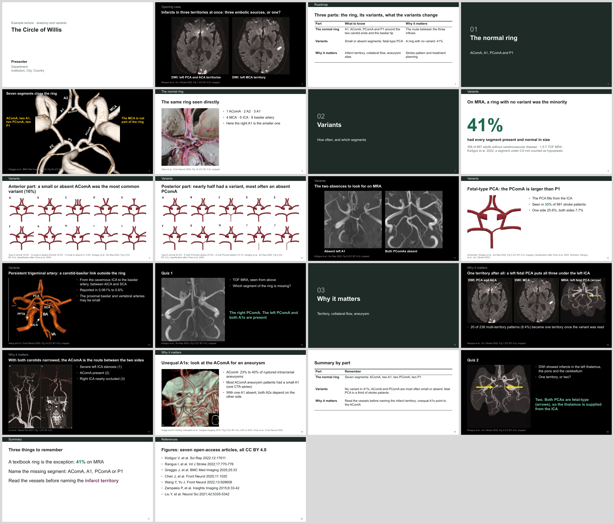

# Presentation

An example 30-minute resident lecture, "The Circle of Willis", built on the medsci slide template
(`skills/present-paper/templates/slide_template/`): pine palette with the section band, and the black
Imaging layouts for the MRA, CTA and DSA slides. It has 22 slides: an opening case, a roadmap table, three
parts with a section divider each, two quizzes with the answer appearing on a click, a summary table, a
take-home slide and the references.

Slide text is English; speaker notes are Korean prose. The anatomy statements and figure descriptions follow
the text and captions of the cited articles. Every figure is cropped from an open-access article; credits and
licences are in `assets/SOURCES.md`.



The image is a PowerPoint render of the built deck.

`build_deck.py` starts the deck with `new_deck.make_deck(palette="pine", band=True)` and fills it by layout
name and placeholder idx: `put_rich` for the spans in the two accent colours, `fit_picture` for whole
figures, `plain_table` and `set_cell` for the two tables, `credit` for the source lines and
`appear_on_click` for the quiz answers. The numbers on the slides are in dicts at the top of the script, each
with the article and section it is quoted from.

```bash
bash make_deck.sh        # build demo6_circle_of_willis.pptx and run both gates
```

`make_deck.sh` runs two checks, with the archetype and length declared in `deck.qc`:

- `check_slide_tells.py`: the marks that make a deck read as machine-made.
- `check_deck_budget.py`: words per slide, slides per minute and a type-size floor, for a `didactic`
  lecture of 30 minutes.

Figure credits and licences: see `assets/SOURCES.md`.
